# pytest-shm

**Faster tests for code that saves files, by keeping pytest's temporary files in memory instead of on disk.**

<div style="text-align: center; margin: 2rem 0;">
  
</div>

Install it and run pytest as usual.
There is nothing to configure, and most test suites need no changes.

## The problem: waiting on the disk

When a program saves something it cannot afford to lose, writing the file is not enough.
The operating system first keeps written data in memory and copies it to the disk a little later, so a power cut could still lose it.
To be sure, the program asks the operating system to push the data all the way to the disk and waits until the disk confirms.
That request is called `fsync`.

SQLite does this on every commit by default, and careful code that replaces a file safely ("atomic writes") does it too.
Each `fsync` takes from a fraction of a millisecond to many milliseconds, depending on the disk.
In production that wait is the price of not losing data.
In tests it buys nothing, because nobody needs a test's files to survive a power cut.
A suite that saves data thousands of times can spend most of its time just waiting on the disk.

## The fix: a folder that lives in memory

Linux has a folder, `/dev/shm`, that looks like any other folder but keeps its files in memory.
The name is short for *shared memory*, because programs use it to share data through memory, and the kind of filesystem behind it is called *tmpfs*.
Files there can be created, written, read, and deleted like any other file, but `fsync` has no disk to wait for, so it returns immediately.

pytest-shm moves pytest's temporary files into `/dev/shm`.
That covers `tmp_path`, `tmp_path_factory`, and every file or folder your code creates with Python's `tempfile` module.
Because those files take up memory, the plugin also cleans up what the test session created after a passing run, and keeps it after a failing run so you can inspect it.
[How it works](how-it-works.md) and the [caveats](caveats.md) list what it leaves behind.

## Does it help?

That depends on how much of your suite waits on `fsync`.
As one data point, [MindRoom](https://github.com/mindroom-ai/mindroom) has about 26,000 tests that commit SQLite transactions and write files atomically throughout:

| Measurement | Without pytest-shm | With pytest-shm |
| --- | --- | --- |
| Summed test time, 32 workers on an NVMe disk | 5236 s | 1426 s |
| GitHub Actions test step | about 16 min | 12-15 min |

To measure your own suite, compare a plain `pytest` run with `pytest -o shm_min_free_gib=inf`, which keeps the plugin off.

Tests that check your code survives a crash still mean the same thing.
They simulate the program crashing, not the machine losing power, and data a crashed program already handed to the operating system is safe whether or not it reached the disk.
The [caveats](caveats.md) list the few differences other tests can notice.

## Installation

```bash
uv add --dev pytest-shm
# or
pip install pytest-shm
```

It needs Python 3.10+ and pytest 8.4+, and pytest loads it automatically.
It only acts on Linux, and only when `/dev/shm` is safe to use; elsewhere, and whenever you export `TMPDIR` to a folder other than `/dev/shm`, it leaves your temporary files where they are, so it is safe to add to cross-platform projects.
The report header at the top of each run tells you whether it is active:

```text
shm: temp root /dev/shm
```

or why it is not:

```text
shm: off, TMPDIR is exported
```

## Next steps

- [How It Works](how-it-works.md): what moves where, what gets cleaned up, and when the plugin stays off.
- [Configuration](configuration.md): the free-space threshold and how to turn the plugin off.
- [Caveats](caveats.md): what other tests can notice.
